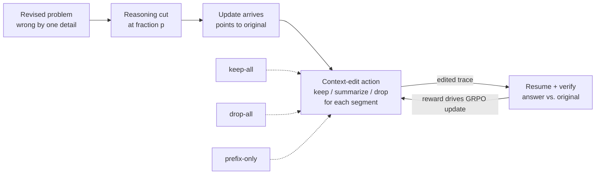
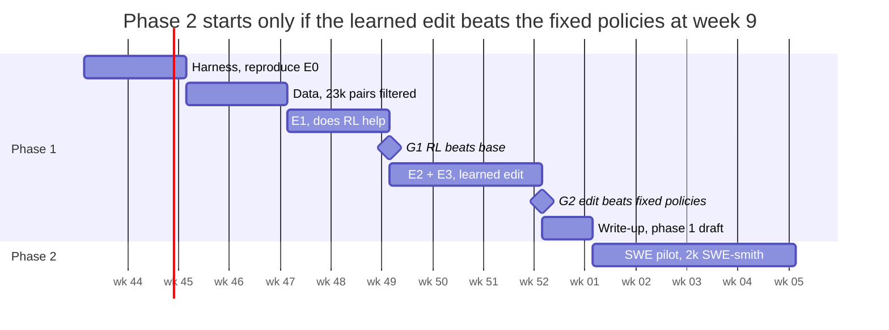

# Interruptible Reasoning: Research Plan

2026-10-20 · Helen

## Thesis

A reasoning model that is interrupted mid-thought should decide for itself which of its prior reasoning to keep, rewrite, or discard, and it can learn that decision from the correctness of the redirected outcome alone. Today the decision is made outside the model: serving systems keep whatever token prefix still matches (RETIRE), and behavioral work keeps the whole partial trace (Never Stop Thinking). Neither asks the model, and both leave stale reasoning in context, which is the mechanism behind two documented failure modes: self-doubt (Berkeley) and contextual inertia (EchoChain).

**Research questions**

1. RQ1 (trainability). Does RL with a verifiable reward on the redirected task reduce the three Berkeley failure modes (reasoning leakage, panic, self-doubt) on held-out problems, without a judge in the loop?
2. RQ2 (cache management). Does a learned context-edit action, applied at the interruption point, beat both fixed policies (keep everything, drop everything) on redirected accuracy and on tokens to answer?
3. RQ3 (transfer). Does a policy trained on single-generation math and code interruptions transfer to agentic interruptions where state also lives in a filesystem, and what breaks when it does not?

**Claimed contribution**, if the experiments succeed: the first training recipe that treats the interruption point as a decision over the model's own context, with the comparison against serving-side and behavioral baselines that each keep state by a fixed rule. If RQ2 fails, the negative result still settles whether the model needs the choice at all.

## Prior work and the gap

The field has benchmarks and serving fixes but no trained model that chooses what to keep at an interruption. The table lists what each line of work does with the model's prior state when new instructions arrive.

| Work | Setting | What it does | State at the interruption | Trains a model? |
| --- | --- | --- | --- | --- |
| [Are LRMs Interruptible? (Berkeley Sky, ICML 2026)](https://arxiv.org/abs/2510.11713) | Math and code, interruption inside the chain of thought | Benchmark of hard, soft, and update-driven interrupts; finds leakage, panic, self-doubt | Partial trace kept, update appended | No, prompt guidance only |
| [InterruptBench (UIC, 2026)](https://arxiv.org/abs/2604.00892) | WebArena-Lite agents, interruption between actions | Benchmark of addition, revision, retraction; 165 tasks x 3 types | Trajectory and web state kept | No |
| [RETIRE (NVIDIA, 2026)](https://arxiv.org/abs/2610.01160) | vLLM serving | Versioned execution: revoke old output, inherit the certified KV prefix | Longest common token prefix kept, by rule | No, model untouched |
| [Never Stop Thinking (2026)](https://arxiv.org/abs/2609.17416) | Continuous-time agents, Qwen3-8B | Force-closes the thinking block on interrupt; fine-tunes under five reward signals | Whole partial trace kept in KV | Yes; judge rewards hurt, verifiable rewards help |
| [AsyncReasoning (2025)](https://arxiv.org/abs/2512.10931) | Interactive thinking, training-free | Absorbs new input mid-thought via rotary-embedding tricks | Everything kept | No |
| [EchoChain (2026)](https://arxiv.org/abs/2604.16456) | Full-duplex voice | Benchmark; finds contextual inertia, interruption amnesia, objective displacement | Kept | No |

Two results shape the method. Never Stop Thinking found that an LLM-judge reward made the model think less but complete fewer verifiable requirements; only a verifiable objective, optimized on-policy, improved content. Berkeley's update-driven split already supplies a verifiable objective, because every update points back to a problem with a known answer. The gap is the column that reads "kept" in every row: no work lets the model decide.

One caveat. The Never Stop Thinking PDF did not render in this review, so its author list and benchmark details come from search snippets and need checking before citation.

## Method

Each training episode interrupts a reasoning trace at a random point, lets the model edit its own context, continues on the updated specification, and rewards only the verifiable outcome. The method has four parts.

The update arrives mid-reasoning, the model edits its own partial trace, and only the verifier's judgment on the original problem feeds back into training. The three dashed controls replace the edit action in experiment E2.

**Interruption protocol.** Follow Berkeley's update-driven setup exactly, so results are comparable. The model starts on a revised (wrong) problem, reasoning is cut at a fraction p of its full-run length (p in {0.3, 0.5, 0.7, 0.9}), and an update message is injected that redirects to the original problem. The injection role is a design choice: Berkeley tested both appending inside the thinking block and adding a user turn. Start with the user-turn variant because it matches how agents receive interruptions.

**Context-edit action.** At the interruption point the model emits a short structured action before it resumes. The partial trace is split into segments at paragraph boundaries (Berkeley's ablation shows paragraph-level cuts behave like token-level cuts). For each segment the action is one of keep, summarize, or drop. The edited trace replaces the original before generation continues. Three fixed policies serve as controls: keep-all (Never Stop Thinking's behavior), drop-all (cold restart), and prefix-only (keep segments up to the first one that references a changed detail, which approximates what RETIRE's token-prefix rule preserves). Implementation note: the first version operates on text, not on KV tensors. A summarized segment is re-encoded, so the KV cache is rebuilt for that span. KV-level editing is a phase-two optimization, not a research dependency.

**Reward.** Correctness of the final answer on the original (post-update) problem, from a string-match grader for math and test-case execution for code. No judge. Two optional shaping terms, each ablated with weight zero:

$$
R = \mathbb{1}[\text{correct}] - \lambda_{\text{ans}} \cdot \max\left(0, \frac{L_{\text{answer}} - B}{B}\right) - \lambda_{\text{restart}} \cdot \max\left(0, \frac{L_{\text{post}} - L_{\text{clean}}}{L_{\text{clean}}}\right)
$$

The first term penalizes answer-segment length above a budget B, which targets reasoning leakage without touching reasoning depth. The second charges only for post-interruption tokens beyond what a clean solve of the updated problem costs, which removes the incentive to restart from scratch without inducing panic. Both weights stay below 0.2 so a correct answer always outranks a short wrong one. Report lengths as metrics in every run regardless of weights.

**Training.** GRPO (group relative policy optimization: each sampled response is scored against the other responses to the same prompt, which removes the need for a value model) on Qwen3-8B in thinking mode, 8 rollouts per prompt, verifiable reward, with the verl or TRL trainer. Skip SFT unless the base model fails to emit the edit action under prompting; Berkeley showed prompt guidance alone recovers part of the update-driven loss, which suggests the format is learnable in-context. Hold interruption position and update type fixed within a group so the group's advantage reflects the policy, not the difficulty of the cut.

## Phase 1 data: synthesis for math and competitive code

Training data is synthesized from training splits with Berkeley's perturb-and-correct recipe, and the two public benchmarks are held out as evals. Ground truth is free because every update points back to a problem whose answer is already known.

**Pipeline.** For each source problem: (1) an LLM perturbs one critical detail to produce a revised problem; (2) the same LLM writes a natural-language update that corrects it back; (3) a strong solver answers the revised problem; (4) keep the pair only if that answer differs from the original. Step 4 is the necessity filter from InterruptBench. Without it the model is rewarded for ignoring updates. Target yield after filtering: 20k math pairs and 3k code pairs. Berkeley's `data/augmentation/prompts.py` and `math_intervene.py` are the starting prompts; replace GPT-5 with a cheaper generator and spot-check 50 pairs by hand so perturbations are not a single template.

| Source | Split used | Size before filter | Verifier | Overlap risk with evals |
| --- | --- | --- | --- | --- |
| [GSM8K](https://huggingface.co/datasets/openai/gsm8k) | train only | 7.5k | exact match | Berkeley sampled 500 GSM8K problems; confirm they came from test before using train |
| [MATH](https://huggingface.co/datasets/hendrycks/competition_math) | train only | 7.5k | symbolic match | MATH500 is drawn from the test split, so train is clean |
| [Big-Math](https://arxiv.org/pdf/2502.17387) | subset by solve rate | 250k available | exact match | dedupe against MATH500 and AIME by problem text |
| [TACO](https://huggingface.co/datasets/BAAI/TACO) or [APPS](https://huggingface.co/datasets/codeparrot/apps) | train | 25k / 5k | test-case execution in a sandbox | exclude any problem dated Oct 2024 to May 2025 (Berkeley's LiveCodeBench window) |
| AIME 2024, 2025 | none | 60 | | eval only, never train |

**Held-out evals.**

- [update-interrupt-benchmark](https://huggingface.co/datasets/dynamic-lm/update-interrupt-benchmark) (Berkeley, Apache-2.0): 1,060 math and 341 code rows, test split only, with Berkeley's grading scripts. Primary in-distribution eval.
- Berkeley's hard and soft interrupt modes, run with the same scripts, to measure leakage and panic even though training targets updates.
- [InterruptBench](https://github.com/HenryPengZou/InterruptBench): out-of-distribution agentic eval, phase 2 only, because it needs the WebArena docker stack and a web-agent scaffold.

**Difficulty stratification.** Panic and self-doubt appear mostly on long traces. GSM8K traces are short, so weight sampling toward MATH level 4 to 5 and Big-Math problems with a base-model solve rate between 0.2 and 0.8, where GRPO's group advantage is informative.

## Phase 1 experiments

The experiment that decides the project is E3: the learned context edit must beat the better of keep-all and drop-all. Everything before it establishes that training works at all; everything after it explains why.

| ID | Question | Arms | Metric | Decides |
| --- | --- | --- | --- | --- |
| E0 | Reproduce Berkeley | Qwen3-8B, no training, p in {0.3, 0.5, 0.7, 0.9} | update-driven accuracy vs. static | Our harness matches their numbers within 2 points |
| E1 | Does RL help at all (RQ1)? | base vs. GRPO with keep-all context, λ = 0 | accuracy at each p; leakage, panic, self-doubt rates | Go/no-go for the whole direction |
| E2 | Fixed policies | keep-all, drop-all, prefix-only, each untrained and each trained | accuracy, post-interruption tokens | Which fixed rule is the real baseline |
| E3 | Learned edit (RQ2) | trained edit action vs. best of E2 | accuracy, tokens, edit statistics | The paper's main claim |
| E4 | Reward shaping | λ_ans and λ_restart in {0, 0.05, 0.1, 0.2} | accuracy, answer length, panic rate | Whether shaping is load-bearing |
| E5 | Position and type | p sweep; addition vs. revision vs. retraction updates | accuracy by cell | Where the learned edit pays off |
| E6 | Hard and soft interrupts | trained model under Berkeley's time-constrained modes | accuracy, leakage | Whether update training transfers to other interrupt kinds |

**Metrics.** Accuracy on the post-update problem is primary. Berkeley's three failure modes are measured with their definitions: leakage as answer-segment length relative to the uninterrupted answer, panic as premature termination under a speedup instruction, self-doubt as a wrong answer that matches the pre-update problem. Add two of our own: edit rate (fraction of segments dropped or summarized) and stale-reference rate (final answer uses a detail the update retracted).

**Analysis for E3.** If the learned edit wins, report what it learned: which segments it drops as a function of whether they reference the changed detail, and how the drop rate varies with p. If it loses to keep-all, the model does not need the choice and the paper becomes an RQ1 result plus a negative finding on context editing. If it loses to drop-all, the base model cannot identify stale segments, which motivates the SFT warm start.

**Seeds and reporting.** Three seeds per arm. Report mean and standard deviation; a difference under one standard deviation is not a result.

## Phase 2: agentic software engineering

Phase 2 moves the same recipe to multi-step coding agents, where stale state lives in the filesystem and in tool outputs as well as in the reasoning trace. It starts only after E3 returns a positive result.

**Setting.** Perturb a SWE task's issue description, let the agent edit files toward the wrong version, then interrupt with the correction. Reward is the original task's fail-to-pass tests. The context-edit action now ranges over prior tool outputs and file diffs, not only reasoning segments, so the question becomes which observations are still valid after the update. This is the regime InterruptBench measures for web agents.

**Data.** Training instances come from executable SWE training sets, never from SWE-bench or Terminal-Bench, which are test sets.

| Source | Instances | Repos | Environment |
| --- | --- | --- | --- |
| [SWE-smith](https://arxiv.org/abs/2504.21798) | ~50k synthetic | 128 | one Docker image per repo |
| [SWE-Gym](https://arxiv.org/pdf/2602.09892) | 2.4k real | 11 | Docker |
| [R2E-Gym](https://arxiv.org/pdf/2602.09892) | 4.6k synthetic | 10 | Docker |

Start with SWE-smith for scale. A subset of 2k instances, perturbed and filtered the same way as phase 1, is enough for a first run.

**Evals.** SWE-bench Verified (500) with injected interruptions as the primary eval; InterruptBench for web agents as a cross-domain check, since its interruption types (addition, revision, retraction) map directly onto ours. Terminal-Bench 2.0 (89 tasks) is too small to train on and is used, if at all, as a final report-only number.

**Cost.** Each reward needs a container run and a test suite, typically 30 seconds to several minutes, against milliseconds for math. With 8 rollouts per prompt, 2k prompts is 16k container runs per epoch. Budget this before starting; it is the reason phase 2 waits for phase 1.

**What changes in the method.** Segments become tool-call blocks (call plus observation). Summarize is more valuable here than in math, because a long file read may stay useful even when the goal changed. The serving-side baseline is also sharper: RETIRE's prefix rule keeps the repository context both plans share, which is the right thing, and the question is whether the model can do better by also dropping the obsolete plan steps that follow it.

## Compute, timeline, and milestones

Phase 1 fits on a single 8-GPU node and about ten weeks; phase 2 needs a container farm and is scoped after the E3 gate.

**Compute.** GRPO on an 8B model with 8 rollouts and traces up to 8k tokens runs comfortably on 8x H100 80GB (vLLM for rollouts, FSDP for updates). One training run of 20k prompts is on the order of a day; the E1 to E4 matrix with three seeds is roughly 30 run-days, so a two-week wall-clock budget with runs in parallel. Data synthesis is API cost only: 30k generations plus 30k solver calls. Phase 2 adds Docker hosts for test execution; estimate from the measured per-run cost in week 11.

**Gates.** The weeks in the roadmap are targets, each a review point. The one that matters is E3 at week 9: a positive result unlocks phase 2, a negative one ends the project at a phase 1 write-up. A negative G1 at week 6 ends it earlier.

## Risks and kill criteria

The project has two ways to fail honestly and three ways to fool itself; the table names each with its tripwire.

| Risk | What it looks like | Tripwire | Response |
| --- | --- | --- | --- |
| RL does not help (RQ1 fails) | E1 trained model within noise of base at every p | E1 result at week 6 | Stop. Report the negative result with the harness; no phase 2 |
| Keep-all is already optimal | E3 learned edit loses to keep-all on accuracy and ties on tokens | E3 at week 9 | Paper becomes RQ1 plus a negative finding on context editing |
| Reward hacking via restart | Edit policy converges to drop-all; post-interruption tokens equal a clean solve | Edit-rate and token curves during E3 | Enable λ_restart; if accuracy then drops, the model cannot identify stale segments and needs SFT warm start |
| Reward hacking via leakage | Answer length grows while accuracy holds | Answer-length curve in E1 | Enable λ_ans at 0.05; confirm panic rate does not rise |
| Trained-in panic | Speedup-mode accuracy falls after training (E6) | E6 | Lower λ values; add soft-interrupt prompts to training mix |
| Synthetic data too easy to pattern-match | Updates share a template; model learns the template, not the task | 50-pair manual check at week 4; held-out accuracy gap vs. Berkeley's GPT-5-written updates | Diversify perturbation prompts; add a second generator model |
| Eval contamination | Training set overlaps MATH500, AIME, or Berkeley's GSM8K sample | Text-dedupe before week 4 | Drop overlapping items; re-run |
| Phase 2 cost | Container runs exceed budget before a first signal | Measured per-run cost at week 11 | Shrink to 500 prompts and 4 rollouts; or report phase 2 as a pilot |

**Kill criteria, stated in advance.** The project stops after phase 1 if either E1 shows no improvement over base, or E3 shows the learned edit losing to both fixed policies across all three seeds. Both outcomes are still publishable as negative results with the released harness and data, which is the floor on the project's value.

## Open questions

- [ ] Does "know when to cut off" mean the model decides when to stop and read an incoming interruption, or how much to discard once one arrives? This plan assumes the second. The first is a separate timing problem closer to AsyncReasoning.
- [ ] Which split did Berkeley sample its 500 GSM8K problems from? Determines whether GSM8K train is safe.
- [ ] Is the Never Stop Thinking benchmark public, and is it close enough to Berkeley's to serve as a third eval?
- [ ] verl or TRL for GRPO with a structured action before continuation; which trainer handles the mid-rollout context rewrite with less custom code?
- [ ] Should summarize be a real option in phase 1, or only keep and drop? Fewer actions make E3 cleaner; summarize is where phase 2 pays off.
- [ ] Latent-space (continuous chain-of-thought) variant: deferred until the text version works, since it is harder to train and harder to inspect.

## Sources

- [Are Large Reasoning Models Interruptible? (arXiv 2510.11713)](https://arxiv.org/abs/2510.11713) and [project page](https://dynamic-lm.github.io/)
- [interrupt-lrm repository](https://github.com/dynamic-lm/interrupt-lrm) and [update-interrupt-benchmark dataset](https://huggingface.co/datasets/dynamic-lm/update-interrupt-benchmark)
- [When Users Change Their Mind: InterruptBench (arXiv 2604.00892)](https://arxiv.org/html/2604.00892v1) and [repository](https://github.com/HenryPengZou/InterruptBench)
- [Serving a Revisable World: RETIRE (arXiv 2610.01160)](https://arxiv.org/pdf/2610.01160)
- [Never Stop Thinking: Continuous-Time Language Agents (arXiv 2609.17416)](https://arxiv.org/pdf/2609.17416)
- [Asynchronous Reasoning (arXiv 2512.10931)](https://arxiv.org/pdf/2512.10931)
- [EchoChain (arXiv 2604.16456)](https://arxiv.org/pdf/2604.16456)
- [Big-Math (arXiv 2502.17387)](https://arxiv.org/pdf/2502.17387)
- [SWE-smith (arXiv 2504.21798)](https://arxiv.org/abs/2504.21798) and [SWE dataset comparison in Scale-SWE (arXiv 2602.09892)](https://arxiv.org/pdf/2602.09892)
- [Terminal-Bench 2.0 (arXiv 2601.11868)](https://huggingface.co/papers/2601.11868)
